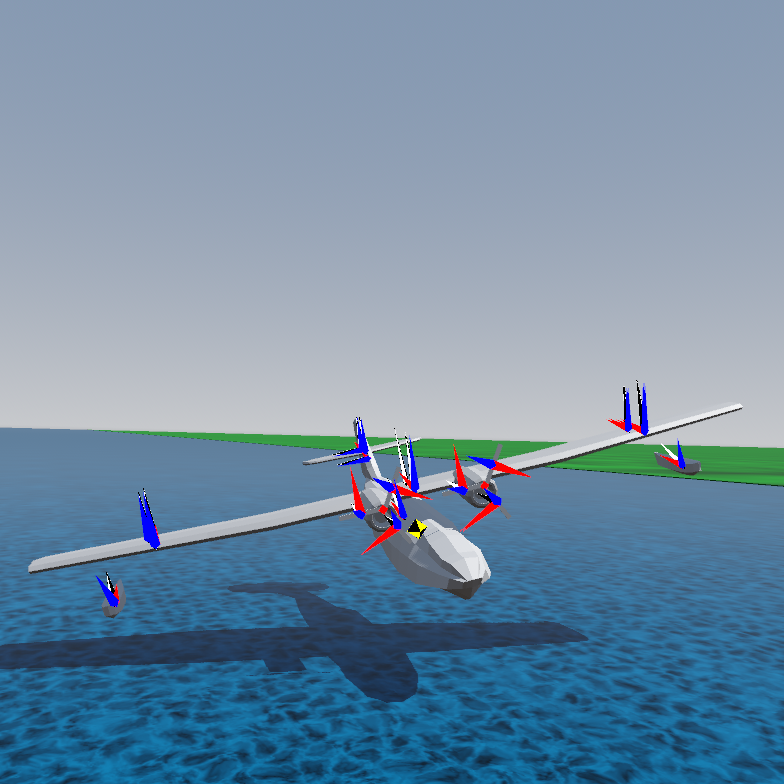

# Godot Aerodynamic Physics
### Aerodynamic physics plugin written primarily in C++ for the Godot Engine with deep customizability and high performance.

## Installation
- Download/Install from the [Godot Asset Library](https://godotengine.org/asset-library/asset/2580) (Preferred)
- Enable plugin in project settings `Project > Project Settings > Plugins`

> [Advanced installation](docs/advanced_install.md)

## Basic Usage
- Add an  AeroBody to your scene, and add one or more  AeroInfluencer3D derived classes as children, adjust settings to change the characteristics.

> [Getting Started](docs/getting_started/getting_started.md)

## Written in C++
- Native GDExtension, prebuilt for Windows, Linux, macOS, and Android (x86_64 and arm64).
- Single and double precision binaries, double is recommended for large world coordinates.
- Fully scriptable, GDScript classes can extend the built-in nodes and override simulation callbacks.

## Development Direction

1. Usability, stability, and performance.
2. More AeroInfluencer3D derived nodes (Dynamic rotor systems, primitive shapes).
3. Aerofoil profiles for AeroSurfaces.
4. Energy–maneuverability graphs and aircraft performance profiling.
5. And [More](CONTRIBUTING.md/#future-features)

> [How to contribute](CONTRIBUTING.md)

## Helpful documentation

- [Getting Started](docs/getting_started/getting_started.md)
- [Compiling](docs/compiling.md)
- [Getting Familiar with Aero Nodes](docs/getting_started/getting_familiar_with_aero_nodes.md)
- [Aerodynamic Design](docs/advanced_concepts/aerodynamic_design.md)
- [Using Atmospheres](docs/getting_started/using_atmospheres.md)
- [Control Theory](docs/advanced_concepts/control_theory.md)
